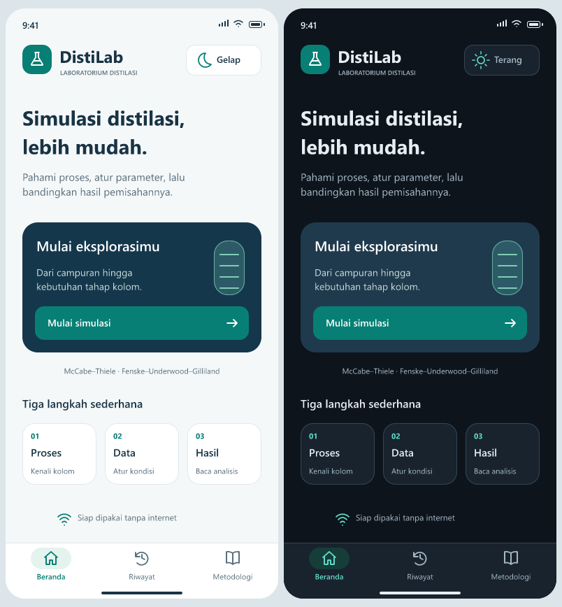

# DistiLab

Simulasi distilasi biner untuk Android. Hitung tahap kolom, jelajahi grafik, dan bandingkan skenario secara offline.

**[Unduh APK 1.10](https://github.com/naufalhisyampakpahan/DistiLab/releases/download/apk-v1.10.0/DistiLab-1.10.0.apk)** · Android 7.0 atau lebih baru



## Fitur

- Mode terang dan gelap; pilihan tersimpan otomatis.
- Alur Proses → Data → Hasil.
- McCabe–Thiele dan Fenske–Underwood–Gilliland.
- Grafik, analisis sensitivitas, dan perbandingan skenario.
- Riwayat studi, ekspor CSV, dan verifikasi 27 kasus dengan ekspor XLSX.

## Mulai

Pasang APK, pilih **Mulai simulasi**, isi data, lalu tekan **Hitung kolom**. Ganti tema lewat tombol di kanan atas Beranda.

Model memakai distilasi biner ideal dengan volatilitas relatif konstan. Hasil adalah perhitungan model, bukan data eksperimen.

## Pengembangan

Node.js ≥ 22.13, React Native, dan Expo.

```sh
npm ci
npm start
```

Pemeriksaan: `npm run check`. Build APK: [panduan Android](docs/BUILD_ANDROID.md).

[Metodologi](docs/METODOLOGI.md) · [Validasi](docs/VALIDASI.md) · [Desain FigCraft](design/figcraft/DistiLab-Desain.figcraft)
